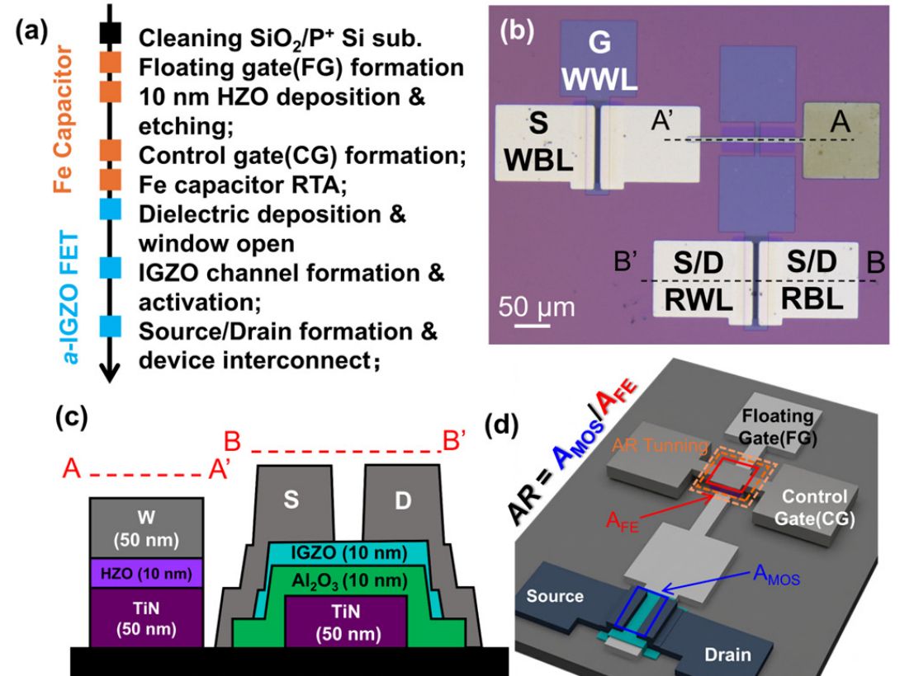

## A 1T–1MFMIS FeFET-Based Computing-in-Memory Cell With 2.3 V Memory Window and Multibit Storage

## Abstract
Computing-in-memory (CiM) has emerged as a promising solution to overcome the memory wall in data-intensive applications. However, conventional oxide semiconductor-based memory devices suffer from limited retention and insufficient multibit capability, restricting their practical deployment. In this work, a hybrid 1T–1MFMIS ferroelectric field-effect transistor (FeFET) memory cell, consisting of a dedicated write transistor (Wtr) and a physically separated MFMIS FeFET read transistor (Rtr), is proposed for nonvolatile computing-in-memory applications. By leveraging the synergistic interaction between ferroelectric (FE) polarization and charge trapping (CT) effects, the device achieves a large memory window of 2.3 V and a high on/off ratio of ~10⁶. The MFMIS Rtr exhibits endurance up to 10⁸ cycles at room temperature. Its two-state retention was measured to 1000 s and extrapolated to 10 years at room temperature. The complete 1T–1MFMIS cell demonstrates 3 bit/cell (8 levels), with retention measured to 2000 s at room temperature. System-level simulation using DNN+NeuroSim V1.4 yields an energy efficiency of 75.63 TOPS/W under the specified simulation conditions. These results highlight the strong potential of the proposed 1T–1MFMIS FeFET for high-density and energy-efficient CiM applications.
[[Link to Journal website (IEEE)]](https://ieeexplore.ieee.org/document/11769916)

Congratulations, Simin!
