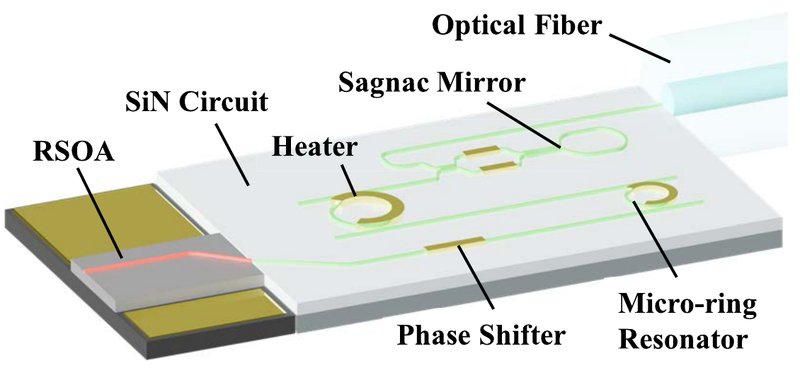

## Design and fabrication of a silicon nitride double-ring Vernier filter for narrow-linewidth external-cavity laser in co-packaged optics

## Abstract
We propose a silicon nitride (SiN) double-ring Vernier filter as a wavelength-selective passive feedback element for co-packaged optics. Designed for an external-cavity laser targeting an intrinsic linewidth below 10 kHz near 1550 nm, the filter exhibited simulated FWHM and insertion loss values of 0.017 nm and 4.14 dB, respectively, compared with measured values of 0.019 nm and 4.03 dB. Applying 14.04 mW to the heater of the 170-µm-radius ring compensated for fabrication-induced resonance mismatch, forming a Vernier passband near 1551 nm. Increasing the heater power to 47.35 mW induced a blue shift of approximately 0.92 nm through Vernier hopping, demonstrating coarse wavelength tuning toward 1550 nm. These results support the filter’s potential application in SiN PIC-based narrow-linewidth external-cavity lasers for co-packaged optics.
[[Link to Journal website (Optica)]](https://opg.optica.org/oe/fulltext.cfm?uri=oe-34-24-45301)

Congratulations, Kyungjin!
